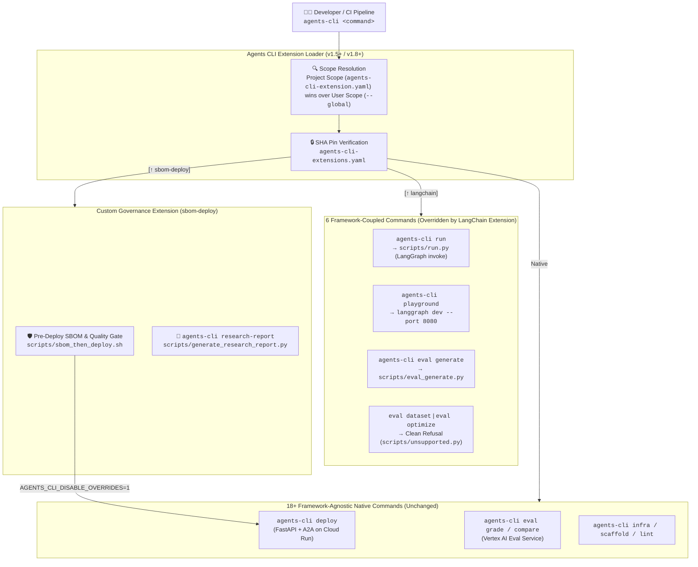
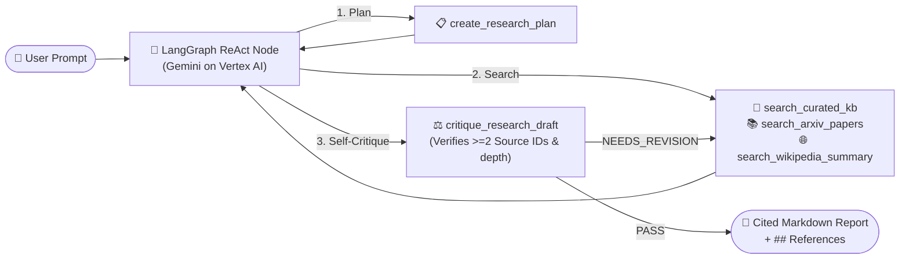

# DeepCite: LangChain & LangGraph on Google Agents CLI (`scalfod-langgraph-agentscli`)

[](https://github.com/google/agents-cli)
[](https://langchain-ai.github.io/langgraph/)
[](https://google.github.io/A2A/)
[](https://developers.googleblog.com/powering-the-agent-development-lifecycle-with-any-framework-from-adk-to-langchain-and-beyond/)
[](#)

> **Powering the Agent Development Lifecycle (ADLC) with any framework—from ADK to LangChain, LangGraph, and beyond.**  
> This repository is a complete, production-ready reference project and live workshop demonstrating how to **scaffold, run, inspect, evaluate, govern, and deploy a pure LangChain / LangGraph agent** using the **Google Agents CLI (`agents-cli`) Extension System**—with **zero `google-adk` dependency**.

---

## 🌟 What This Project Demonstrates

1. **Zero-ADK LangChain / LangGraph Lifecycle**:
   - Built with `langchain.agents.create_agent` compiling into a LangGraph `CompiledStateGraph` (`root_agent` in `app/agent.py`).
   - Intercepts the 6 framework-coupled commands (`run`, `playground`, `eval.generate`, `eval.dataset`, `eval.optimize`, `publish.gemini-enterprise`) via `agents-cli-extension.yaml` while inheriting all ~18 framework-agnostic commands (`deploy`, `eval grade`, `eval compare`, `infra`, `lint`, `login`) untouched.
2. **DeepCite Iterative Research & Critique Agent (`Plan → Search → Critique → Report`)**:
   - **`create_research_plan`**: Decomposes technical research prompts into structured sub-questions.
   - **`search_curated_kb` / `search_arxiv_papers` / `search_wikipedia_summary`**: Retrieves grounded evidence with verifiable source IDs (`[KB-...]`, `[ARXIV-...]`, `[WIKI-...]`) and deterministic offline fallbacks for reproducible CI evaluations.
   - **`critique_research_draft`**: Audits draft responses for citation density, coverage, and grounding before final synthesis.
3. **Custom Enterprise CLI Extensions (`commands.override` + `commands.add`)**:
   - **New Command (`agents-cli research-report`)**: Executes the LangGraph agent, verifies inline citations, and exports a timestamped Markdown report to `reports/`.
   - **Command Override (`extensions/sbom-deploy`)**: Wraps `agents-cli deploy` with a Software Bill of Materials (SBOM) & pre-deploy governance check, then delegates safely to native `agents-cli deploy` using the built-in `AGENTS_CLI_DISABLE_OVERRIDES=1` recursion guard.

---

## 🏛️ Architecture & Extension Lifecycle

### 1. How the `agents-cli` Extension System Works



### 2. DeepCite LangGraph Execution Flow (`app/agent.py`)



---

## 📂 Repository Structure

```text
scalfod-langgraph-agentscli/
├── agents-cli-extension.yaml      # Auto-loaded project-scope LangChain overrides + `research-report` command
├── agents-cli-manifest.yaml       # Project configuration (deployment_target: cloud_run)
├── langgraph.json                 # LangGraph Studio dev-server configuration
├── pyproject.toml                 # Pure LangChain + LangGraph dependencies (Zero google-adk!)
├── Dockerfile                     # Cloud Run container serving FastAPI + A2A on port 8080
├── app/
│   ├── agent.py                   # Exports `root_agent: CompiledStateGraph` built with `create_agent`
│   ├── tools.py                   # Plan, Curated KB, ArXiv, Wikipedia, and Self-Critique tools
│   ├── fast_api_app.py            # Exposes `app: FastAPI` with `/invoke`, `/health`, and A2A routes
│   └── app_utils/
│       ├── a2a.py                 # `/.well-known/agent.json` and `/a2a/tasks/send` handlers
│       └── telemetry.py           # Cloud Trace and structured logging setup
├── scripts/
│   ├── run.py                     # Drop-in override for `agents-cli run`
│   ├── eval_generate.py           # Drop-in override for `agents-cli eval generate`
│   ├── publish.py                 # Agent-Runtime-aware publish wrapper
│   ├── unsupported.py             # Explicit refusal handler for ADK-only simulator commands
│   └── generate_research_report.py# Custom `agents-cli research-report` command implementation
├── extensions/
│   └── sbom-deploy/               # Custom Enterprise SBOM & Governance Extension
│       ├── agents-cli-extension.yaml
│       └── scripts/
│           ├── sbom_then_deploy.sh
│           └── sbom_report.sh
├── tests/
│   └── eval/
│       ├── datasets/basic-dataset.json
│       └── eval_config.yaml
└── reports/                       # Exported Markdown research reports
```

---

## ⚡ End-to-End Command Walkthrough (Technical Session Guide)

### Step 0: Prerequisites & Authentication

```bash
# 1. Install or upgrade Google Agents CLI (requires v1.8.0+)
uvx google-agents-cli setup
agents-cli --version

# 2. Authenticate with Google Cloud & enable Vertex AI + Cloud Run APIs
gcloud auth application-default login
gcloud config set project YOUR_PROJECT_ID
gcloud services enable aiplatform.googleapis.com run.googleapis.com artifactregistry.googleapis.com
```

---

### Step 1: Scaffold from the First-Party LangChain Template (or Clone This Repo)

```bash
# Option A: How this project was scaffolded via Agents CLI v1.8.0+
agents-cli create scalfod-langgraph-agentscli \
    --agent google/agents-cli/extensions/langchain/template@v1.8.0 \
    -d cloud_run

# Option B: Install dependencies directly in this repository
cd scalfod-langgraph-agentscli
uv sync
agents-cli install
```

Verify that the project has **zero dependency on `google-adk`**:

```bash
grep -r "google.adk\|google-adk" pyproject.toml app/ ; echo "exit: $?"
# Expected output: exit: 1 (no matches!)
```

---

### Step 2: Inspect the Active Extension Overrides

```bash
# Check which commands are intercepted by the project-scope extension (`[↑ langchain]`)
agents-cli --help | grep -E "playground|run|research-report"

# Inspect the full extension command mapping
agents-cli info
```

Expected output from `agents-cli info`:
```text
Extensions (experimental):
  eval.dataset  (override, project) <- langchain: uv run python scripts/unsupported.py eval dataset
  eval.generate  (override, project) <- langchain: uv run python scripts/eval_generate.py
  eval.optimize  (override, project) <- langchain: uv run python scripts/unsupported.py eval optimize
  playground  (override, project) <- langchain: uv run langgraph dev --no-browser --port 8080
  publish.gemini-enterprise  (override, project) <- langchain: uv run --with pyyaml python scripts/publish.py
  run  (override, project) <- langchain: uv run python scripts/run.py
  research-report (add, project) <- langchain: uv run python scripts/generate_research_report.py
```

---

### Step 3: Run the LangGraph Agent & Local Playground

```bash
# Quick smoke test
agents-cli run "what's the weather in San Francisco?"

# Run the full DeepCite iterative workflow (Plan -> Search -> Critique -> Cited Report)
agents-cli run "How does the Google Agents CLI Extension System work and how does it support LangChain and LangGraph?"

# Run with verbose tool-trajectory output
uv run python scripts/run.py -v "Compare single-pass RAG with iterative Agentic Self-Reflection workflows and cite foundational papers."

# Launch LangGraph Studio on port 8080 (replaces the ADK Web UI)
agents-cli playground
```

---

### Step 4: Export a Cited Research Report (`commands.add` Demo)

We added a custom `research-report` command in `agents-cli-extension.yaml`:

```bash
# Run via Agents CLI extension command (or directly via uv)
agents-cli research-report "Compare single-pass RAG vs Agentic Self-Reflection workflows"

# Inspect the generated Markdown report with verified citations
ls -la reports/
```

---

### Step 5: Run Framework-Agnostic Evaluations (`eval generate` + `eval grade`)

`eval generate` is overridden to drive our LangGraph `CompiledStateGraph`, while `eval grade` and `eval compare` use the native Vertex AI Evaluation Service:

```bash
# 1. Generate evaluation traces from the LangGraph agent
agents-cli eval generate \
    --dataset tests/eval/datasets/basic-dataset.json \
    -o tests/eval/output/

# 2. Grade the generated traces using native Vertex AI rubrics
agents-cli eval grade \
    --traces tests/eval/output/basic-dataset.json \
    --config tests/eval/eval_config.yaml

# 3. Verify that ADK-only simulator commands fail cleanly with a helpful message
agents-cli eval dataset synthesize
```

---

### Step 6: Install & Test the Custom `sbom-deploy` Governance Extension

Demonstrate how enterprise platform teams wrap `agents-cli deploy` with an SBOM vulnerability scan (`syft` + `grype`) without causing infinite recursion (`AGENTS_CLI_DISABLE_OVERRIDES=1`):

```bash
# 1. Make the extension wrapper scripts executable
chmod +x extensions/sbom-deploy/scripts/*.sh

# 2. Install the custom local extension into the project
agents-cli extension add local@./extensions/sbom-deploy --yes

# 3. Verify both `langchain` and `sbom-deploy` extensions are active
agents-cli extension list
agents-cli deploy --help

# 4. Run the standalone SBOM audit command added by the extension
agents-cli sbom-report

# 5. Test the overridden `deploy` gate in dry-run mode
agents-cli deploy --dry-run

# 6. Deploy to Google Cloud Run (runs SBOM scan first, then native `gcloud run deploy`)
agents-cli deploy

# 7. Bypass overrides explicitly when needed
AGENTS_CLI_DISABLE_OVERRIDES=1 agents-cli deploy --help
```

---

## 📚 References

- **Google Developers Blog (Oct 21, 2026)**: [Powering the Agent Development Lifecycle with any framework, from ADK to LangChain and beyond](https://developers.googleblog.com/powering-the-agent-development-lifecycle-with-any-framework-from-adk-to-langchain-and-beyond/)
- **Google Agents CLI Repository**: [github.com/google/agents-cli](https://github.com/google/agents-cli)
- **LangGraph Documentation**: [langchain-ai.github.io/langgraph](https://langchain-ai.github.io/langgraph/)
